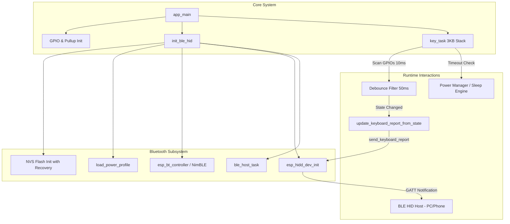
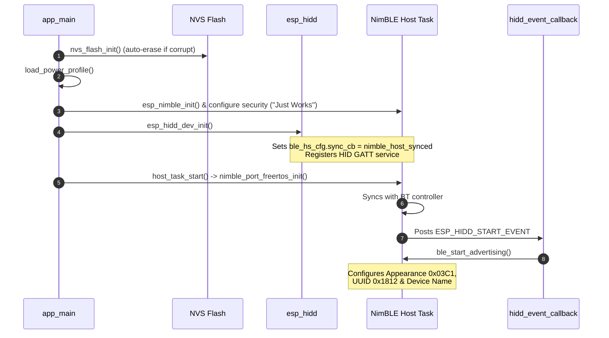
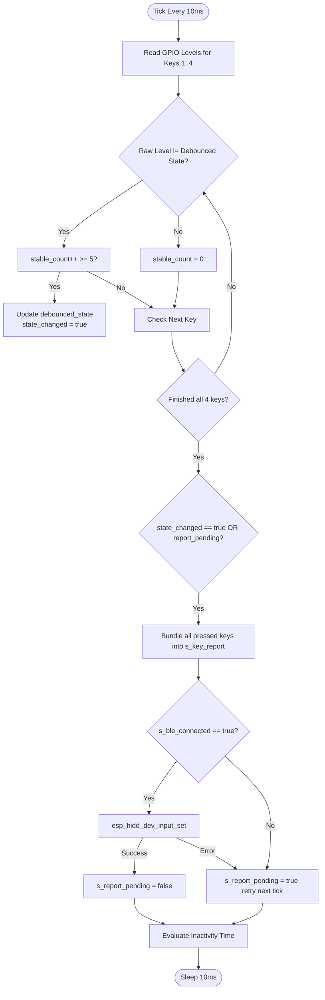
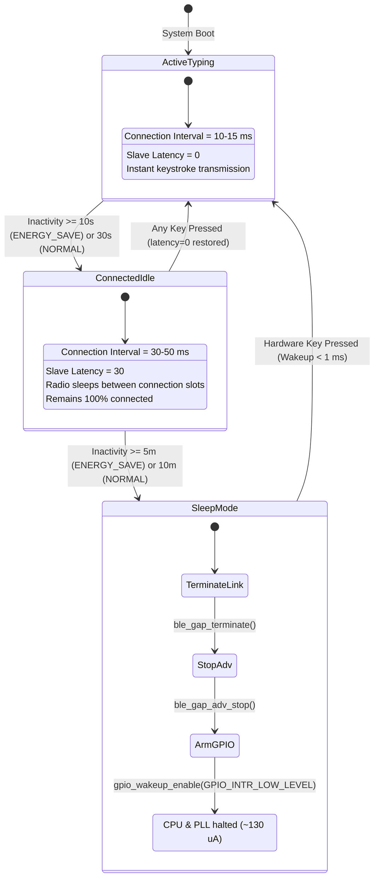

# Software Architecture & System Design

This document details the software architecture, state machines, task models, and protocol implementations of the **Nibble Keypad** firmware.

---

## 1. System Overview & Task Model

The firmware is built on FreeRTOS under the ESP-IDF framework. Concurrency is handled across two primary FreeRTOS tasks:



### Tasks:
1. **`ble_host_task`** (`nimble_port_freertos_init`):
   - Dedicated task running the Apache NimBLE host event loop (`nimble_port_run()`).
   - Manages connection lifecycle, GAP events, L2CAP packets, and GATT attribute notifications.
2. **`key_task`** (`priority 5`, `stack 3072 bytes`):
   - Executes periodic scanning of the hardware GPIOs at a 10 ms period (`SCAN_INTERVAL_MS`).
   - Debounces switch contacts and computes multi-key state changes.
   - Dispatches HID reports to the host via `esp_hidd_dev_input_set()`.
   - Tracks idle duration and coordinates power state transitions.

---

## 2. Boot & Bluetooth Initialization Sequence

To prevent initialization race conditions and missed events, the NimBLE stack must follow a strict registration order:



---

## 3. Key Scanner & Atomic Debounce Pipeline

Key inputs are configured as `GPIO_MODE_INPUT` with internal pull-up enabled. Pressing a key pulls the pin to GND (`active-low = 0`).



### Atomic Multi-Key Rollover:
- Rather than sending individual notifications per key, the entire 4-key state is evaluated per scan loop.
- If two or more keys change within the same 10–50 ms window, they are serialized into a single 8-byte HID report:
  `[modifier, reserved, keycode1, keycode2, 0, 0, 0, 0]`
- Prevents buffer congestion on the BLE notification attribute.

---

## 4. 2-Stage Power Management State Machine

The firmware implements two progressive power-saving tiers to maximize battery longevity without frustrating the user with reconnection delays:



---

## 5. NVS Persistence Schema

Settings are stored in the non-volatile storage partition using the ESP-IDF NVS API under the `"kb_cfg"` namespace:

| Parameter | Type | Key Name | Namespace | Description / Values |
|---|---|---|---|---|
| **Power Profile** | `uint8_t` | `"pwr_mode"` | `"kb_cfg"` | `0` = NORMAL (30s idle / 10m sleep)<br/>`1` = ENERGY_SAVE (10s idle / 5m sleep) |
| **Key Mappings** | `blob` (8 bytes) | `"key_map"` | `"kb_cfg"` | Array of 4 `key_mapping_t` structs (2 bytes each: `modifiers` + `keycode`) |

### Key Mapping Structure:
```c
typedef struct {
    uint8_t modifiers; // Bitmask of KEY_MOD_* (Ctrl, Shift, Alt, GUI)
    uint8_t keycode;   // Standard HID usage code (0x04='a', 0x19='v', etc.)
} key_mapping_t;
```

---

---

## 6. Custom Configuration GATT Service (UUID `0xFFF0`)

The keyboard exposes a dedicated GATT service allowing wireless remapping, power profile adjustment, and complete factory reset without reflashing firmware. This service is also broadcast in the BLE Scan Response packet for instant discovery by mobile apps (e.g. nRF Connect, LightBlue) and Web Bluetooth applications.

### GATT Service Architecture:
- **Service UUID**: `0xFFF0` (Custom Keyboard Configuration Service)

| Characteristic | UUID | Permissions | Length | Format / Description | User Description (`0x2901`) |
|---|---|---|---|---|---|
| **Power Profile** | `0xFFF1` | Read / Write | 1 byte | `0x00`: NORMAL (30s idle / 10m sleep)<br/>`0x01`: ENERGY_SAVE (10s idle / 5m sleep) | `"Power Profile (0=Normal, 1=EnergySave)"` |
| **Key Remapping** | `0xFFF2` | Read / Write | 8 bytes | 4 keys × 2 bytes `[mod0, key0, mod1, key1, mod2, key2, mod3, key3]`<br/>`mod`: Bitmask of `KEY_MOD_*`<br/>`key`: Standard USB HID keycode | `"Key Mappings (4x 2-byte [mod, keycode])"` |
| **Factory Reset** | `0xFFF3` | Read / Write | 1 byte | Write non-zero (e.g. `0x01`) to trigger asynchronous factory reset sequence | `"Factory Reset (Write 1 to clear NVS and forget device)"` |

---

## 7. Factory Reset & Device Unpairing

The firmware provides two redundant mechanisms to restore the keyboard to its factory default state and forget bonded hosts:

### Mechanism 1: Wireless GATT Command (`0xFFF3`)
Writing `0x01` to Characteristic `0xFFF3` triggers an asynchronous FreeRTOS sequence:
1. **Response Transmission (300 ms)**: Allows NimBLE to acknowledge the ATT Write Response (`0x00` OK) back to the client application.
2. **In-Memory Restore**: Reverts key mappings to `'a'`, `'b'`, `'c'`, `'d'` and power mode to `NORMAL`.
3. **NVS Configuration Erasure**: Erases the `"kb_cfg"` namespace (`nvs_erase_all`).
4. **NimBLE Security Database Purge**: Calls `ble_store_clear()` to delete all LTKs, IRKs, bonding keys, and CCCD subscription records.
5. **Connection Termination**: Cleanly terminates the active BLE link (`ble_gap_terminate(s_conn_handle, BLE_ERR_REM_USER_CONN_TERM)`).
6. **Clean Reboot (200 ms)**: Restarts the ESP32-C3 via `esp_restart()`, booting up as a fresh, discoverable, unpaired device.

### Mechanism 2: Hardware Boot Combo Failsafe
If the device is unable to connect to a host (e.g. host OS Bluetooth stack corruption):
- Hold **Key 1 (GPIO 8)** + **Key 3 (GPIO 20)** simultaneously during power-on / reset for **2 seconds**.
- The firmware logs `"Hardware factory reset triggered via Key 1 + Key 3 hold!"`, wipes `"kb_cfg"` NVS, clears the NimBLE bonding store, and reboots.

